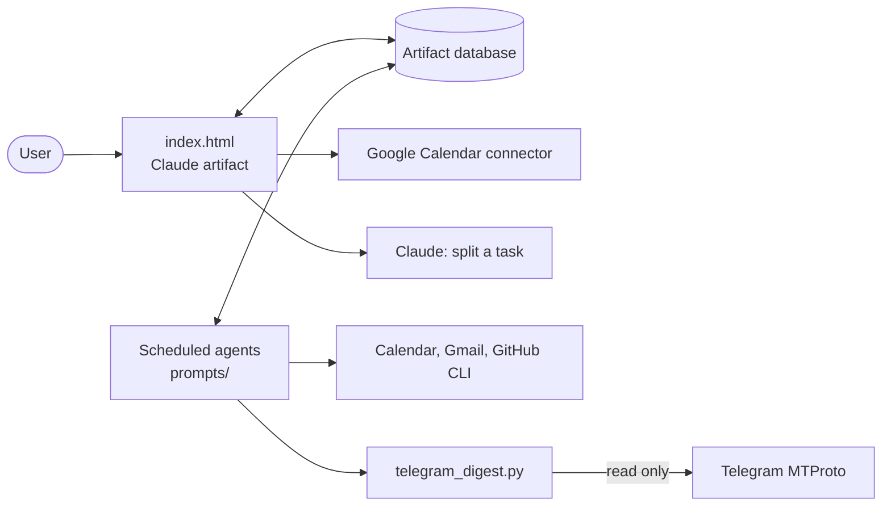

# Pult Dnya

[Русская версия](README.ru.md)

A personal daily dashboard that lives inside Claude. Tasks are managed on a single page;
scheduled Claude agents collect the morning brief from the calendar, mail, Telegram and
GitHub, close forgotten days and write weekly and monthly reviews.

The page is a [Claude artifact](https://claude.ai): its storage, connectors and model calls
come from the artifact runtime (`window.claude.use(...)`), so there is no backend to host.
Opened outside claude.ai, the page renders but cannot load or save data.

## What it does

- **Tasks.** Today, tomorrow and a dateless backlog; urgent flags; moving one task or all
  non-urgent ones; leftovers from past days; recurring tasks.
- **Stuck tasks.** A task moved three or more times gets highlighted, and Claude can split
  it into small steps.
- **Calendar.** Give a task a time slot and it becomes a Google Calendar event that moves
  along with the task.
- **End of day.** A button closes the day and builds a report. If it was not pressed, the
  morning agent closes the day without moving anything.
- **Morning brief.** A short summary with calendar, mail, Telegram and GitHub sections; an
  item that needs action can become a task in one click.
- **Reviews.** Short weekly and monthly results, plus push reminders.

## Architecture



| Path | Purpose |
| --- | --- |
| `index.html` | The dashboard: plain JavaScript, no build step |
| `prompts/` | Instructions of the scheduled agents, with personal values replaced by placeholders such as `<ARTIFACT_URL>` |
| `telegram_digest.py` | Read-only Telegram digest for the morning brief |
| `tests/` | Tests for chat filtering and the blocklist |

## Telegram digest and privacy

Reading a personal account requires a user session, which is powerful, so the script is
built around limiting what leaves the machine:

- **Blocklist.** Blocked chats are dropped before any message is requested and never appear
  in the output, not even as a count. Block individual chats or all private chats at once.
- **Fails closed.** With no blocklist file, all private chats are blocked. With a broken
  one, the digest returns an error and reads nothing.
- **Read only.** The script has no code that sends messages or marks them as read.
- **Minimal storage.** The agent stores the chat name, counters and a short action note,
  never the message text. Message text is treated as data, not as instructions.
- **Secrets stay local.** Credentials and the session file live in `~/.telegram-pult/`,
  outside the repository.

```bash
uv run telegram_digest.py login
```

```bash
uv run telegram_digest.py chats
```

```bash
uv run telegram_digest.py block "Chat name"
```

```bash
uv run telegram_digest.py block-private on
```

`login` asks for `api_id` and `api_hash` from [my.telegram.org](https://my.telegram.org)
and for a login code. Enter them only in your own terminal.

## Tests

```bash
uv run --with telethon==1.45.0 --with pytest python -m pytest
```

## Setting it up

1. Publish `index.html` as a Claude artifact with the `db`, `mcp` (Google Calendar) and
   `sample` capabilities.
2. Create scheduled tasks in the Claude desktop app from `prompts/`, replacing the
   placeholders with your values.
3. Connect Google Calendar and Gmail in claude.ai, and log in to Telegram if you want it.

The scheduled agents run while Claude is open on the computer.
