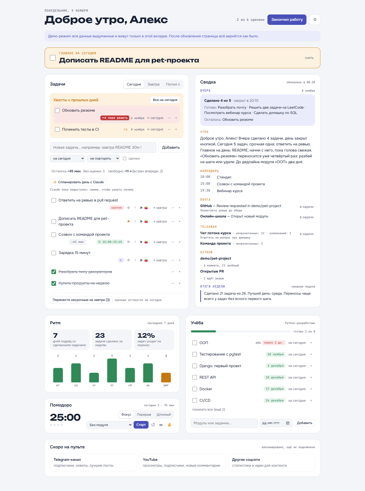
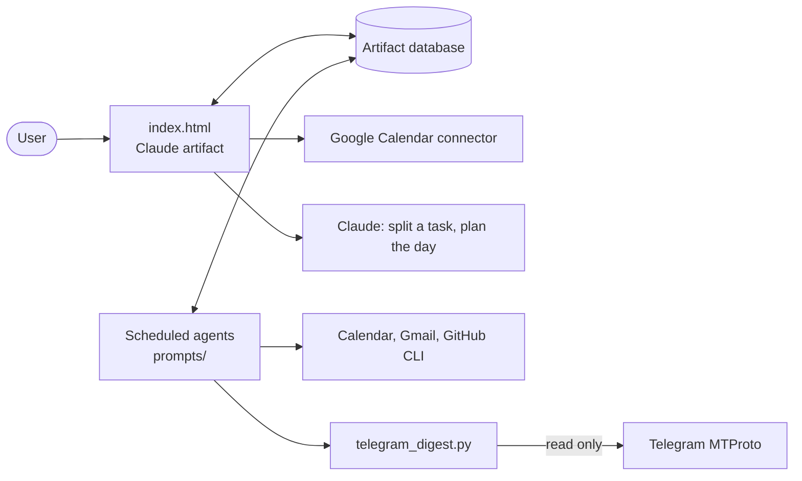

# Day Console

[Русская версия](README.ru.md)

A personal daily dashboard that lives inside Claude (its Russian interface calls it
«Пульт дня», "Day Console"). Tasks are managed on a single page;
scheduled Claude agents collect the morning brief from the calendar, mail, Telegram and
GitHub, close forgotten days and write weekly and monthly reviews.

The page is a [Claude artifact](https://claude.ai): its storage, connectors and model calls
come from the artifact runtime (`window.claude.use(...)`), so there is no backend to host.
Opened outside claude.ai (locally or with `#demo` in the address), the page switches to a
demo mode with made-up data kept in memory, so it can be tried without an account.



## What it does

- **Tasks.** Today, tomorrow and a dateless backlog; urgent flags; moving one task or all
  non-urgent ones; leftovers from past days. Rarely used actions sit in a "⋯" menu.
- **Editing.** Rename a task right in its row (Enter saves, Esc cancels); a linked
  calendar event is renamed too. Recurring tasks can be renamed as well.
- **Notes.** A note under a task, shown in grey, with clickable links.
- **Manual order.** ↑↓ arrows move a task within the list; done tasks sink, urgent ones rise.
- **Undo delete.** After deleting a task or a recurring rule, "Undo" brings it back for
  seven seconds with all its fields and its calendar event.
- **Recurring tasks.** Every day, weekdays, weekends, chosen weekdays, every two weeks, or
  once a month (including the last day of the month); the backlog shows the next date.
- **Smart input.** A date, an estimate, urgency and repetition typed at the start or end of
  a new task are recognised (the parser understands Russian): `Позвонить в банк завтра 30м !`
  ("call the bank tomorrow, 30 min, urgent"), `Спортзал раз в 2 недели` ("gym every two
  weeks"). A preview shows what was understood.
- **Estimates and load.** Each task can have an estimate. A line above the list shows how
  much is left, how much free time remains until 22:00 after meetings, and warns when the
  day does not fit.
- **Plan the day with Claude.** For today or tomorrow, Claude proposes an order, estimates,
  what to move and what to take on. Every change has a checkbox; apply the chosen ones or
  ask for another option.
- **Reopen the day.** A closed day can be reopened, and the tasks moved at closing come
  back to today.
- **Main task for tomorrow.** A star on a tomorrow task pins it on the Tomorrow tab.
- **Stuck tasks.** A task moved three or more times gets highlighted, and Claude can split
  it into small steps.
- **Calendar.** Give a task a time slot and it becomes a Google Calendar event that moves
  along with the task.
- **End of day.** A button closes the day and builds a report. If it was not pressed, the
  morning agent closes the day without moving anything.
- **Morning brief.** A short summary with calendar, mail, Telegram and GitHub sections; an
  item that needs action can become a task in one click.
- **Reviews.** Short weekly and monthly results, plus push reminders.
- **Main task of the day.** One task marked with a star is pinned at the top in large type.
- **Rhythm.** A streak of days with finished tasks, tasks done over the week, the share of
  tasks that get postponed, and a bar chart for the last seven days.
- **Study.** Course modules with deadlines and progress; a module that is due soon is
  highlighted and can be added to today's tasks in one click.
- **Pomodoro timer.** 25/5 minutes with a long break after four rounds, linked to a course
  module. The alarm is scheduled on the audio clock in advance, so it rings on time even in a
  background tab, and a full-screen notice stays until dismissed. Daily counts are saved.
  A compact widget sits under Rhythm. A pomodoro can also be started on a task: the timer
  ticks in its row and finished rounds count towards the task's estimate.
- **No personal data in the code.** The user's name and course are set on the page and kept
  in the artifact database.

## Architecture



| Path | Purpose |
| --- | --- |
| `index.html` | The dashboard: plain JavaScript, no build step |
| `prompts/` | Instructions of the scheduled agents, with personal values replaced by placeholders such as `<ARTIFACT_URL>` |
| `telegram_digest.py` | Read-only Telegram digest for the morning brief |
| `tests/` | Tests for chat filtering and the blocklist |

## Telegram digest and privacy

Reading a personal account requires a user session, which is powerful, so the script is
built around limiting what leaves the machine:

- **Blocklist.** Blocked chats are dropped before any message is requested and never appear
  in the output, not even as a count. Block individual chats or all private chats at once.
- **Fails closed.** With no blocklist file, all private chats are blocked. With a broken
  one, the digest returns an error and reads nothing.
- **Read only.** The script has no code that sends messages or marks them as read.
- **Minimal storage.** The agent stores the chat name, counters and a short action note,
  never the message text. Message text is treated as data, not as instructions.
- **Secrets stay local.** Credentials and the session file live in `~/.telegram-pult/`,
  outside the repository.

```bash
uv run telegram_digest.py login
```

```bash
uv run telegram_digest.py chats
```

```bash
uv run telegram_digest.py block "Chat name"
```

```bash
uv run telegram_digest.py block-private on
```

`login` asks for `api_id` and `api_hash` from [my.telegram.org](https://my.telegram.org)
and for a login code. Enter them only in your own terminal.

## Demo

```bash
python -m http.server 8000
```

Then open `http://localhost:8000/`. Nothing is saved: a page reload restores the demo data.

## Tests

```bash
uv run --with telethon==1.45.0 --with pytest python -m pytest
```

## Setting it up

1. Publish `index.html` as a Claude artifact with the `db`, `mcp` (Google Calendar) and
   `sample` capabilities.
2. Create scheduled tasks in the Claude desktop app from `prompts/`, replacing the
   placeholders with your values.
3. Connect Google Calendar and Gmail in claude.ai, and log in to Telegram if you want it.

The scheduled agents run while Claude is open on the computer.
