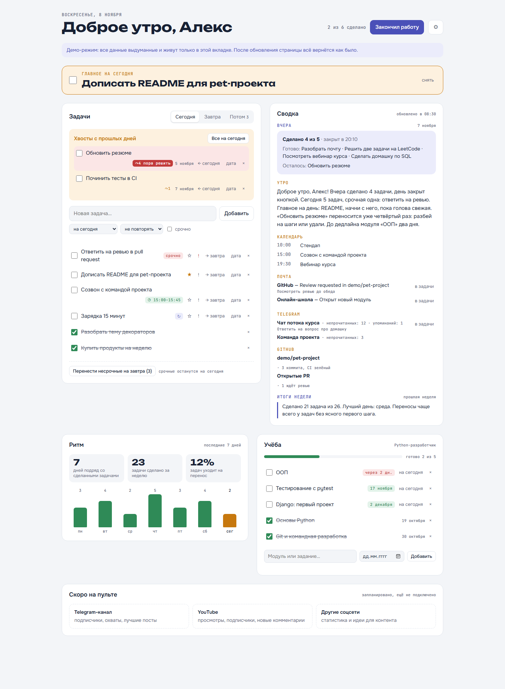
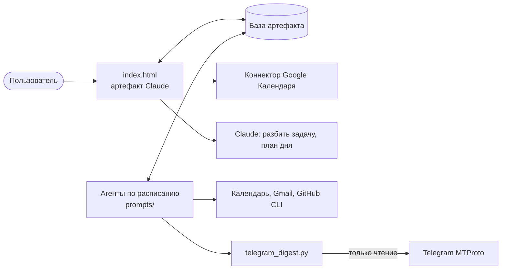

# Пульт дня

[English version](README.md)

Личный дашборд на день, который живёт внутри Claude. Задачи ведутся на одной странице, а
агенты по расписанию собирают утреннюю сводку из календаря, почты, Telegram и GitHub,
закрывают забытые дни и пишут итоги недели и месяца.

Страница является артефактом [Claude](https://claude.ai): хранилище, коннекторы и обращения к
модели даёт среда артефакта (`window.claude.use(...)`), поэтому сервер не нужен. Вне claude.ai
страница (локально или с `#demo` в адресе) переходит в демо-режим: выдуманные данные в
памяти вкладки, попробовать можно без аккаунта.



## Что умеет

- **Задачи.** Сегодня, завтра и бэклог без даты, пометка «срочно», перенос по одной и всех
  несрочных сразу, хвосты с прошлых дней. Редкие действия спрятаны в меню «⋯».
- **Правка.** Название меняется прямо в строке (Enter сохраняет, Esc отменяет), событие в
  Google Календаре переименовывается вместе с задачей. Повторяющиеся задачи тоже.
- **Заметки.** Заметка под задачей серым шрифтом, ссылки в ней кликабельны.
- **Свой порядок.** Стрелки ↑↓ двигают задачу в списке; сделанные уходят вниз, срочные вверх.
- **Отмена удаления.** После удаления задачи или повтора 7 секунд можно нажать «Вернуть»:
  задача вернётся со всеми полями и событием в календаре.
- **Копия задачи.** Сделал половину? Скопируй задачу на завтра, а сегодняшнюю отметь сделанной.
  Можно разложить её на несколько дней подряд (по желанию только по будням) или сделать
  повторяющейся, и тогда сама задача станет первой в серии. Любую копию можно отменить из
  уведомления.
- **Повторы.** Каждый день, по будням, по выходным, по выбранным дням, раз в 2 недели и раз
  в месяц (в том числе в последний день месяца). В «Потом» видна ближайшая дата.
- **Умный ввод.** Дата, оценка, срочность и повтор в начале или в конце новой задачи
  распознаются сами: `Позвонить в банк завтра 30м !`, `Спортзал раз в 2 недели`. Под полем
  видно, что распознано.
- **Оценки и загрузка.** У задачи можно указать оценку времени. Над списком видно, сколько
  осталось работы и сколько свободного времени до 22:00 с учётом встреч, и предупреждение,
  если день не влезает.
- **План дня с Claude.** На сегодня или на завтра Claude предлагает порядок, оценки, что
  перенести и что взять. У каждого изменения галочка: применить выбранное или попросить
  другой вариант.
- **Открыть день снова.** Закрытый день можно открыть, задачи, перенесённые при закрытии,
  вернутся на сегодня.
- **Главное на завтра.** Звёздочка у задачи на завтра закрепляет её на вкладке «Завтра».
- **Застрявшие задачи.** Задача, перенесённая три раза и больше, подсвечивается, и Claude
  может разбить её на маленькие шаги.
- **Календарь.** Задаче можно назначить время: появится событие в Google Календаре, которое
  переносится вместе с задачей.
- **Конец дня.** Кнопка закрывает день и формирует отчёт. Если её не нажали, утренний агент
  закроет день сам, ничего не перенося.
- **Утренняя сводка.** Короткое резюме и разделы по календарю, почте, Telegram и GitHub. То,
  что требует действия, становится задачей в один клик.
- **Итоги.** Короткие итоги недели и месяца и пуш-напоминания.
- **Главное на день.** Задача со звёздочкой закрепляется наверху крупным шрифтом.
- **Ритм.** Серия дней со сделанными задачами, сколько сделано за неделю, какая доля задач
  уходит на перенос, и столбики за последние семь дней.
- **Учёба.** Модули курса с дедлайнами и прогрессом. Горящий модуль подсвечивается, его можно
  одним кликом поставить в задачи на сегодня. При закрытии дня модуль становится пройденным,
  если сегодня сделана его задача, и прогресс обновляется сам. Забытый день так же закрывает
  утренний агент.
- **Помодоро.** 25/5 минут и длинный перерыв после четырёх кругов, с привязкой к модулю курса.
  Сигнал заранее ставится на часы аудиосистемы, поэтому звучит вовремя даже в фоновой вкладке,
  а плашка во весь экран держится, пока её не закроешь. Счёт за день сохраняется.
  Компактный виджет стоит под «Ритмом». Помидор можно запустить и на задачу: таймер тикает в
  её строке, а помидоры вычитаются из оценки.
- **Без личных данных в коде.** Имя и курс задаются на самом пульте и хранятся в базе
  артефакта.

## Архитектура



| Путь | Назначение |
| --- | --- |
| `index.html` | Дашборд: чистый JavaScript без сборки |
| `prompts/` | Инструкции агентов, личные значения заменены плейсхолдерами вроде `<ARTIFACT_URL>` |
| `telegram_digest.py` | Сводка Telegram для утреннего агента, только чтение |
| `tests/` | Тесты отбора чатов и блокировок |

## Сводка Telegram и приватность

Чтобы читать личный аккаунт, нужна пользовательская сессия, а она даёт много прав. Поэтому
скрипт устроен так, чтобы с компьютера уходил минимум:

- **Блокировка.** Закрытые чаты отсекаются до запроса сообщений и не попадают в вывод, даже
  счётчиком. Закрыть можно отдельные чаты или все личные сразу.
- **При сбое закрыто.** Нет файла блокировок: закрыты все личные чаты. Файл испорчен: сводка
  возвращает ошибку и ничего не читает.
- **Только чтение.** В скрипте нет кода, который отправляет сообщения или помечает их
  прочитанными.
- **Минимум данных.** Агент сохраняет название чата, счётчики и короткую формулировку действия,
  но не текст сообщений. Текст сообщений для него данные, а не инструкции.
- **Секреты остаются на компьютере.** Ключи и файл сессии лежат в `~/.telegram-pult/`, вне
  репозитория.

```bash
uv run telegram_digest.py login
```

```bash
uv run telegram_digest.py chats
```

```bash
uv run telegram_digest.py block "Название чата"
```

```bash
uv run telegram_digest.py block-private on
```

`login` спросит `api_id` и `api_hash` с [my.telegram.org](https://my.telegram.org) и код входа.
Вводи их только в своём терминале.

## Демо

```bash
python -m http.server 8000
```

Потом открой `http://localhost:8000/`. Ничего не сохраняется: после обновления страницы демо-данные вернутся.

## Тесты

```bash
uv run --with telethon==1.45.0 --with pytest python -m pytest
```

## Как поднять у себя

1. Опубликуй `index.html` как артефакт Claude с возможностями `db`, `mcp` (Google Календарь) и
   `sample`.
2. Создай задачи по расписанию в приложении Claude из файлов `prompts/`, подставив свои значения
   вместо плейсхолдеров.
3. Подключи Google Календарь и Gmail в claude.ai и, если нужен Telegram, войди в аккаунт.

Агенты по расписанию работают, пока Claude открыт на компьютере.
