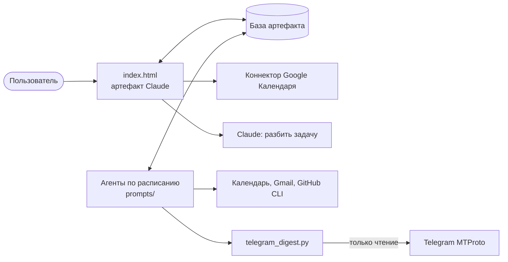

# Пульт дня

[English version](README.md)

Личный дашборд на день, который живёт внутри Claude. Задачи ведутся на одной странице, а
агенты по расписанию собирают утреннюю сводку из календаря, почты, Telegram и GitHub,
закрывают забытые дни и пишут итоги недели и месяца.

Страница является артефактом [Claude](https://claude.ai): хранилище, коннекторы и обращения к
модели даёт среда артефакта (`window.claude.use(...)`), поэтому сервер не нужен. Вне claude.ai
страница откроется, но не сможет загрузить и сохранить данные.

## Что умеет

- **Задачи.** Сегодня, завтра и бэклог без даты, пометка «срочно», перенос по одной и всех
  несрочных сразу, хвосты с прошлых дней, повторяющиеся задачи.
- **Застрявшие задачи.** Задача, перенесённая три раза и больше, подсвечивается, и Claude
  может разбить её на маленькие шаги.
- **Календарь.** Задаче можно назначить время: появится событие в Google Календаре, которое
  переносится вместе с задачей.
- **Конец дня.** Кнопка закрывает день и формирует отчёт. Если её не нажали, утренний агент
  закроет день сам, ничего не перенося.
- **Утренняя сводка.** Короткое резюме и разделы по календарю, почте, Telegram и GitHub. То,
  что требует действия, становится задачей в один клик.
- **Итоги.** Короткие итоги недели и месяца и пуш-напоминания.

## Архитектура



| Путь | Назначение |
| --- | --- |
| `index.html` | Дашборд: чистый JavaScript без сборки |
| `prompts/` | Инструкции агентов, личные значения заменены плейсхолдерами вроде `<ARTIFACT_URL>` |
| `telegram_digest.py` | Сводка Telegram для утреннего агента, только чтение |
| `tests/` | Тесты отбора чатов и блокировок |

## Сводка Telegram и приватность

Чтобы читать личный аккаунт, нужна пользовательская сессия, а она даёт много прав. Поэтому
скрипт устроен так, чтобы с компьютера уходил минимум:

- **Блокировка.** Закрытые чаты отсекаются до запроса сообщений и не попадают в вывод, даже
  счётчиком. Закрыть можно отдельные чаты или все личные сразу.
- **При сбое закрыто.** Нет файла блокировок: закрыты все личные чаты. Файл испорчен: сводка
  возвращает ошибку и ничего не читает.
- **Только чтение.** В скрипте нет кода, который отправляет сообщения или помечает их
  прочитанными.
- **Минимум данных.** Агент сохраняет название чата, счётчики и короткую формулировку действия,
  но не текст сообщений. Текст сообщений для него данные, а не инструкции.
- **Секреты остаются на компьютере.** Ключи и файл сессии лежат в `~/.telegram-pult/`, вне
  репозитория.

```bash
uv run telegram_digest.py login
```

```bash
uv run telegram_digest.py chats
```

```bash
uv run telegram_digest.py block "Название чата"
```

```bash
uv run telegram_digest.py block-private on
```

`login` спросит `api_id` и `api_hash` с [my.telegram.org](https://my.telegram.org) и код входа.
Вводи их только в своём терминале.

## Тесты

```bash
uv run --with telethon==1.45.0 --with pytest python -m pytest
```

## Как поднять у себя

1. Опубликуй `index.html` как артефакт Claude с возможностями `db`, `mcp` (Google Календарь) и
   `sample`.
2. Создай задачи по расписанию в приложении Claude из файлов `prompts/`, подставив свои значения
   вместо плейсхолдеров.
3. Подключи Google Календарь и Gmail в claude.ai и, если нужен Telegram, войди в аккаунт.

Агенты по расписанию работают, пока Claude открыт на компьютере.
